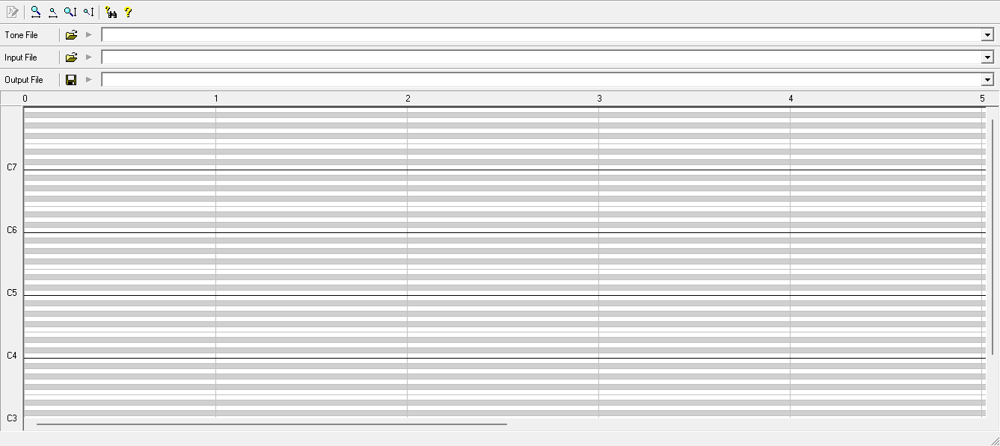

# AmazingMIDI — Static Recompilation

Static recompilation of **AmazingMIDI** 1.70 (arakisoftware, 2003), the
WAV-to-MIDI transcriber, from its shipping Win32 executable, `amazingmidi.exe`
(Visual C++ 6, MFC 4.2), to native C. Its 3,232 functions are lifted to C,
compiled with MSVC and run on pcrecomp's `native32` host, which calls the real
user32, gdi32, comdlg32 and winmm. It runs Araki's own code, not a rewrite, and
it needed no fixes to the program or the toolkit: just lift and build, plus one
seeded function address.

Built on the [pcrecomp](https://github.com/sp00nznet/pcrecomp) toolchain
(branch `main`), following its shared house style like the other
[pcrecomp projects](https://github.com/sp00nznet/pcrecomp#the-projects-that-built-this).

## Getting Started

You need **your own copy of AmazingMIDI 1.70**: the installer `azmid170.exe`
(freeware; the Internet Archive's Tucows collection has it, item
`tucows_327319_AmazingMIDI`). Run it, and use the folder it installs to (by
default `C:\Program Files (x86)\AmazingMIDI`). Nothing of AmazingMIDI is in
this repository or downloaded for you; everything is built on your machine
from your copy. There is no installer release yet.

### The setup scripts

1. Download this repository (the green **Code** button, then **Download ZIP**)
   and unzip it somewhere with 300 MB free.
2. Windows: double-click **`Setup.cmd`**. (`setup.sh` says why there is no
   Linux or macOS build yet, and stops.)
3. Run it with the **`AmazingMIDI`** shortcut in that folder.

The script asks before installing anything (Python 3.10+, `pefile` and
`capstone`, git, the Visual Studio 2022 C++ Build Tools), clones pcrecomp
`main` beside the repo if it isn't there, finds AmazingMIDI in its default
folder or asks (`-GameDir <folder>` skips the question, `-Yes` answers yes),
then catalogs, lifts and builds `build\amazingmidirecomp.exe`. About 3 minutes
once the tools are there; a rerun skips finished steps, and the details are in
`setup.log`. Building by hand and the command line are in
**[docs/building.md](docs/building.md)**.

## Status

**v0.1.0, alpha.** It transcribes, and its output matches the original byte
for byte. The conformance harness (`tools/midi_diff.py`) transcribes a
generated scale with the original and the recomp and compares the .mid files:
**1/1 identical** (SKIP on a machine without the program).

| | |
|---|---|
| Functions found (`disasm32`) | 3,232 |
| Lifted to C | 3,233, 0 errors (57 with no terminator found) |
| Imports | 365 bound to real Windows, 7 shimmed, 0 unresolved |
| Main window, menus, file dialogs, Transcribe | work |
| .mid output vs the original | byte-identical (harness 1/1; `sample.wav` checked by hand) |
| Play (MCIWnd), Help (WinHelp), headless mode | not yet |

Tested against pcrecomp `main` at `93a7432` (Setup.cmd from a fresh clone, 2026-11-12). [ROADMAP.md](ROADMAP.md) is what
comes next.

## Screenshots

The main window, running as recompiled native code, above. More to come with
the headless recorder.

## Documentation

- [docs/building.md](docs/building.md): building by hand, the command line, the one seed
- [docs/testing.md](docs/testing.md): the conformance harness and the dry run
- [docs/architecture.md](docs/architecture.md): the parts and the data flow
- [ROADMAP.md](ROADMAP.md), [CHANGELOG.md](CHANGELOG.md), [CONTRIBUTING.md](CONTRIBUTING.md)

## Contributors

See **[CONTRIBUTORS.md](CONTRIBUTORS.md)** for who did what.

## License

MIT for this repository's own code ([LICENSE](LICENSE)). AmazingMIDI is ©
1998-2003 arakisoftware; none of its files, and nothing generated from them,
is in this repository ([NOTICE.md](NOTICE.md)).
